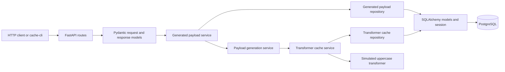
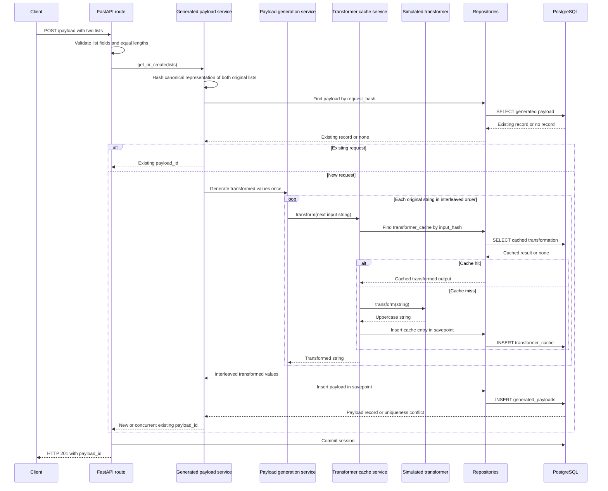
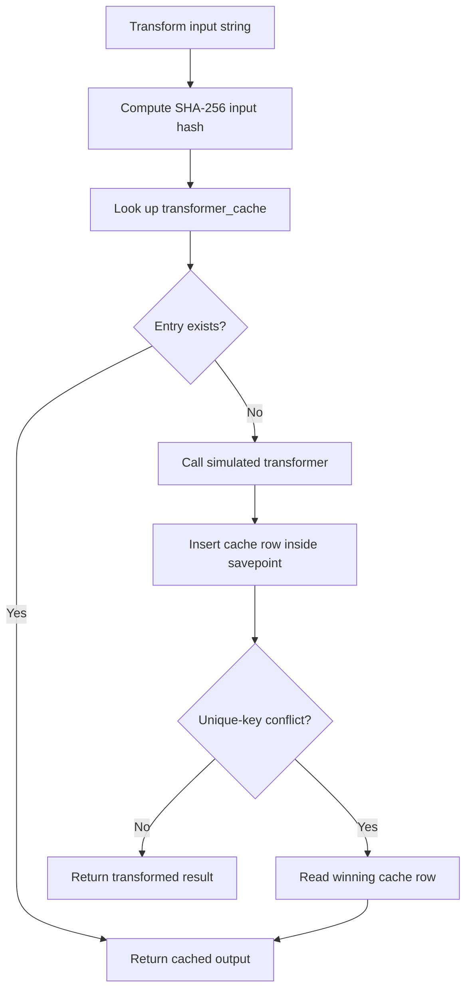
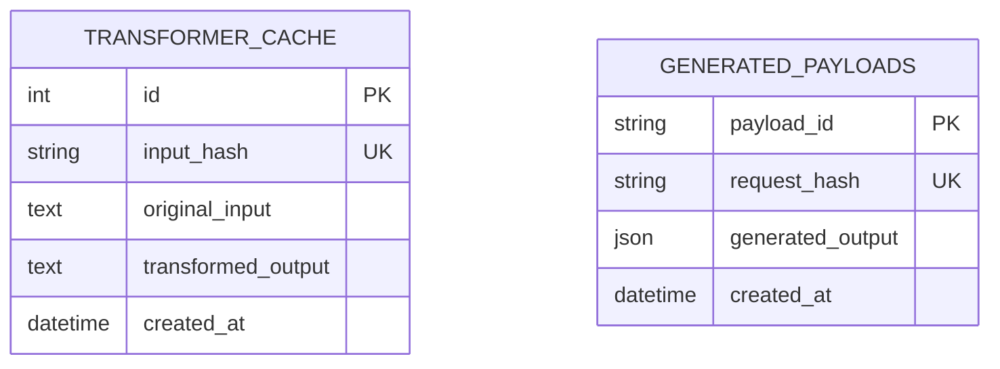

# TT Cache Service

A Python 3.12+ FastAPI service that uppercases and interleaves two string lists, caches individual transformation results in PostgreSQL, and reuses payload IDs for repeated requests.

## Quick Start — Commands First

Clone the repository (replace the placeholder with its actual URL):

```bash
git clone <REPOSITORY_URL> tt-cache-service
cd tt-cache-service
```

Create local configuration, then build and start the API and PostgreSQL:

```bash
cp .env.example .env
docker compose up --build -d --wait
```

The `.env` copy is optional: Compose uses the same development defaults when it is absent. Check health and submit a payload:

```bash
API_URL=http://localhost:8000
curl "$API_URL/health"

PAYLOAD_ID=$(curl --fail --silent -X POST "$API_URL/payload" \
  -H 'Content-Type: application/json' \
  -d '{"list_1":["first string","second string"],"list_2":["other string","another string"]}' \
  | python3 -c 'import json,sys; print(json.load(sys.stdin)["payload_id"])')
printf 'payload_id=%s\n' "$PAYLOAD_ID"
curl "$API_URL/payload/$PAYLOAD_ID"
```

Illustrative responses:

```json
{"status":"ok"}
{"payload_id":"<generated-uuid>"}
{"output":"FIRST STRING, OTHER STRING, SECOND STRING, ANOTHER STRING"}
```

Open interactive API docs at <http://localhost:8000/docs>. Run the PostgreSQL-backed tests and stop the services with:

```bash
make test
docker compose down
```

`docker compose down` retains the `postgres_data` volume. Use `docker compose down -v` only when you intend to delete persisted database data.

## Prerequisites and Configuration

- Python 3.12 or newer for local development and the CLI.
- Docker with Docker Compose V2 for the recommended run and test workflows.
- PostgreSQL 16 is provided by Compose. The service uses PostgreSQL for both transformer cache entries and generated payloads.

### Environment

`.env.example` contains the local development values. Copy it to `.env` and edit it when needed:

```bash
cp .env.example .env
```

`.env` is local-only and must not be committed; it is ignored by Git. `.env.example` is safe to commit and documents the required PostgreSQL variables:

| Variable | Purpose | Development default |
| --- | --- | --- |
| `POSTGRES_DB` | PostgreSQL database used by the API | `cache_db` |
| `POSTGRES_USER` | PostgreSQL login user | `cache_user` |
| `POSTGRES_PASSWORD` | PostgreSQL password | `cache_user_dev` |

Docker Compose reads `.env` for interpolation and applies matching defaults if the file or individual values are absent. It constructs the API's `CACHE_DATABASE_URL` from these same values. The Makefile reads the resolved Compose configuration for local development and test URLs, so there is no second password setting. The defaults are for local development only; use managed credentials and set `CACHE_DATABASE_URL` explicitly outside this setup.

The application settings use Pydantic Settings with the `CACHE_` prefix and read `.env`. `CACHE_DATABASE_URL` can configure the SQLAlchemy connection directly. The CLI accepts `CACHE_CLI_` settings such as `CACHE_CLI_HOST` and `CACHE_CLI_REPEAT`; command-line arguments override environment defaults.

### Local Development Without a Containerized API

The API can run locally while PostgreSQL runs in Compose:

```bash
python3.12 -m venv .venv
. .venv/bin/activate
make install
make dev
```

`make dev` starts PostgreSQL, derives the local connection URL from the resolved Compose configuration, initializes the schema, and runs Uvicorn with reload enabled at <http://localhost:8000>. Stop the local server with Ctrl-C; the database container remains available. The CLI is installed in `.venv/bin/cache-cli` after `make install`.

## Project Purpose and Requirements

The service accepts two equal-length lists, transforms every string, and interleaves the transformed values. Database-backed transformation caching avoids repeating work for previously seen strings. Request-level deduplication gives an identical original request its existing payload ID. FastAPI exposes this behavior over HTTP, PostgreSQL persists it across processes, and `cache-cli` provides a separate HTTP client.

The implementation includes a simulated uppercase transformer, PostgreSQL models and uniqueness constraints, a FastAPI API, a Pydantic-configured CLI, Docker Compose, and unit/integration tests. The transformer is local code rather than a real external service.

## Features and API Reference

### `GET /health`

Reports that the API process is running. It returns HTTP 200 with `{"status":"ok"}`. It does not query PostgreSQL and is not a database-readiness check.

### `POST /payload`

Accepts two same-length lists of strings. Each value is uppercased by the simulated transformer (or loaded from the transformation cache), then values are interleaved by index. The response is HTTP 201 and contains a payload ID.

Request:

```json
{
  "list_1": ["first string", "second string"],
  "list_2": ["other string", "another string"]
}
```

Response:

```json
{"payload_id":"<generated-uuid>"}
```

An existing identical request returns the same payload ID. A missing field, non-string list item, malformed JSON, or unequal list lengths is rejected with HTTP 422. Empty lists are valid and produce an empty output.

### `GET /payload/{payload_id}`

Returns the generated values formatted as a comma-and-space-separated string:

```json
{"output":"FIRST STRING, OTHER STRING, SECOND STRING, ANOTHER STRING"}
```

An unknown ID returns HTTP 404 with `{"detail":"Payload not found"}`.

## Architecture Overview

The API route receives and validates requests with Pydantic models, then delegates to services. The payload service asks the transformer-cache service for each value and interleaves results. The generated-payload service hashes the original request, checks for an existing payload, and persists a new payload when necessary. Repositories isolate SQLAlchemy queries. The CLI is an HTTP client and does not access the database directly.



## Request Lifecycle and Data Flow

The request hash lookup happens before transformation, so an exact repeat skips payload generation and all cache lookups. The initial lookup can race with another request; PostgreSQL's unique constraint arbitrates the insert.



Cache lookup behavior:



## Database Design

The application has two independent tables and no foreign-key relationship between them. SQLAlchemy `create_all` initializes tables at startup; this project does not include schema migrations.



- `transformer_cache` stores one transformed result per SHA-256 input hash. `original_input` is retained to detect a hash collision. The unique constraint on `input_hash` enforces one row for a given input key.
- `generated_payloads` stores interleaved output as a JSON string array. Its UUID `payload_id` is the public identifier; the unique constraint on `request_hash` enforces one payload row per exact original request.
- Both tables have creation timestamps. No additional indexes or foreign keys are defined; the unique constraints provide indexes for the lookup keys.

## Caching and Deduplication Strategy

### Transformer-result cache

The service computes SHA-256 over each input string's UTF-8 bytes. It looks up `transformer_cache.input_hash` before calling the transformer. A hit returns the stored output; a miss calls the transformer and inserts the result. PostgreSQL's unique constraint prevents duplicate cache rows. An insert uses a savepoint so an `IntegrityError` from a competing insert does not invalidate the surrounding request transaction; the service then reads and returns the winning row.

Two simultaneous cold requests can both call the transformer before one wins the insert. The unique constraint prevents duplicate persisted rows but does not prevent duplicate external work. The current transformer is inexpensive local code, so no locking infrastructure is used.

### Generated-payload deduplication

The service serializes `[list_1, list_2]` as compact JSON with Unicode preserved, then hashes those bytes with SHA-256. This retains each list's boundary, order, and original values. Consequently, requests with different list boundaries or ordering remain distinct even if they would happen to produce the same output.

The service checks `generated_payloads.request_hash` before generating output. If the row exists, its UUID is returned. Otherwise, output is generated and inserted in a savepoint. The database unique constraint arbitrates concurrent identical requests; if a competing insert wins, the service reads and returns its payload ID. This guarantees one persisted payload record for an exact request, not one transformer call during simultaneous cold requests.

The API route commits after the service returns. Transformer-cache and payload inserts participate in that request transaction, so an outer rollback discards both. A GET uses a read session that is closed after the request.

## CLI Usage

After `make install`, run `cache-cli --help`. The actual short option for host is uppercase `-H` because lowercase `-h` is reserved for help.

| Option | Behavior |
| --- | --- |
| `-H`, `--host URL` | API base URL; default `http://localhost:8000`. |
| `-r`, `--repeat N` | Send the same request N times; integer must be at least 1. |
| `-i`, `--input FILE\| -` | Read JSON from a file, or stdin when the value is `-`. |
| `-j`, `--json JSON` | Read JSON from the argument itself. |
| `-o`, `--output FILE\| -` | Write one response JSON line per request to a file, or stdout when `-` (default). |
| `-h`, `--help` | Show command help. |

Exactly one input source is required. `--input` and `--json` are mutually exclusive. Pydantic validates CLI settings and the API request body; Pydantic Settings can also read defaults from `CACHE_CLI_` environment variables.

```bash
# Direct JSON; stdout is the default.
cache-cli --json '{"list_1":["hello"],"list_2":["world"]}'

# JSON file to output file.
cache-cli --input request.json --output responses.jsonl

# stdin to stdout.
cat request.json | cache-cli --input - --output -

# Send the same logical request three times; responses have one JSON line each.
cache-cli --repeat 3 --json '{"list_1":["hello"],"list_2":["world"]}'

cache-cli --help
```

Invalid settings, input JSON, missing input files, and payload validation errors produce a nonzero exit code and an error on stderr. HTTP errors, timeouts, and invalid response bodies return exit code 4; input failures return 3; output-file failures return 5. Argument/configuration errors use argparse's exit code 2. File paths are read and written as UTF-8. The CLI issues one HTTP POST per repetition and does not reuse a persistent HTTP client.

## Testing and Development Commands

Use these actual Makefile targets:

| Command | Purpose |
| --- | --- |
| `make install` | Create `.venv` and install the package plus development dependencies. |
| `make dev` | Start Compose PostgreSQL, initialize tables, and run local Uvicorn. |
| `make test` | Run the full test suite against PostgreSQL database `cache_test`. |
| `make lint` | Run Ruff lint checks. |
| `make format` | Format Python files with Ruff. |
| `make check` | Run lint, formatting verification, and the full test suite. |
| `make docker-up` | Build and start both Compose services in the background. |
| `make docker-down` | Stop Compose services without deleting the database volume. |
| `make docker-test` | Start PostgreSQL and run tests against `cache_test`. |
| `make clean` | Remove tool caches and build artifacts. |
| `make help` | Show target summaries. |

The test fixture uses PostgreSQL when `TEST_DATABASE_URL` is set; otherwise it uses a temporary SQLite database for isolated tests. `make test` and `make check` set the dedicated PostgreSQL test URL using credentials resolved from Docker Compose. Test fixtures drop and recreate tables, so do not point `TEST_DATABASE_URL` at a database with data you need to preserve. PostgreSQL is required for the concurrent insert integration test; that test skips when the fixture is using SQLite.

Run focused tests with `.venv/bin/python -m pytest tests/unit/test_cli.py` or `.venv/bin/python -m pytest tests/integration/test_payload_api.py`. Type checking is not configured in this repository.

## Docker and Deployment

The Dockerfile uses `python:3.12-slim`, installs the application dependencies, runs as an unprivileged user, initializes the SQLAlchemy schema, and starts Uvicorn. Compose defines:

- `cache-service`, published on port 8000; it waits for the PostgreSQL health check and has an HTTP health check on `/health`.
- `postgres`, using `postgres:16-alpine`, published on `127.0.0.1:5432`, with persistent storage in the named `postgres_data` volume.

Build and start with `docker compose up --build -d --wait`; view logs with `docker compose logs -f`; stop with `docker compose down`. The health endpoint checks that the API process responds, not that database queries succeed. The Compose defaults and password are for local assessment use, not production deployment. A production deployment should supply managed credentials, configure `CACHE_DATABASE_URL`, use controlled schema migrations, and use an appropriate readiness/secret-management setup.

## Project Structure

```text
.
├── app/
│   ├── api/                  # FastAPI routes, dependencies, and Pydantic schemas
│   ├── cli/                  # cache-cli settings, parsing, and HTTP client
│   ├── core/config.py        # Pydantic application settings
│   ├── models/               # SQLAlchemy table models
│   ├── repositories/         # Database queries and inserts
│   ├── services/             # Transformer caching, payload generation and deduplication
│   ├── database.py           # Engine, session factory, and metadata initialization
│   ├── init_db.py            # Development/container schema initialization entry point
│   └── main.py               # FastAPI application and health endpoint
├── tests/
│   ├── integration/          # API and PostgreSQL concurrency tests
│   └── unit/                 # Services, models, CLI, and database tests
├── .env.example              # Safe local PostgreSQL example values
├── Dockerfile
├── docker-compose.yml
├── Makefile
└── pyproject.toml
```

## Design Decisions and Trade-offs

- FastAPI provides the HTTP layer and OpenAPI documentation; Pydantic validates request models and CLI configuration.
- SQLAlchemy separates repository queries from services. Request-scoped sessions use one reusable PostgreSQL engine and are closed by FastAPI dependency cleanup.
- SHA-256 keys use the exact original string/request, preserving case, order, Unicode, and list boundaries. The simulated transformer currently uppercases each string.
- PostgreSQL unique constraints provide cross-request deduplication and settle concurrent insert races. Savepoints let a losing insert recover while preserving the surrounding request transaction.
- `create_all` keeps startup simple for this assessment but does not provide schema evolution. The CLI performs separate HTTP requests and supports JSON lines for repeated results.
- PostgreSQL is used for the required database-backed tests; SQLite fallback supports isolated unit tests. The integration concurrency behavior is verified against PostgreSQL by `make test`.

## Limitations and Future Improvements

- The transformer is simulated with Python `str.upper()`; no external transformer is called.
- Concurrent cold cache misses may call a future expensive transformer more than once, although only one cache row persists.
- There is no cache expiration, eviction, or schema migration system.
- `/health` is a process liveness check and does not verify PostgreSQL connectivity.
- Compose contains development defaults and is not a production deployment configuration.
